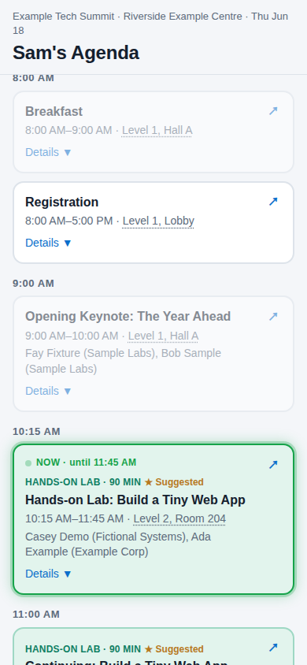
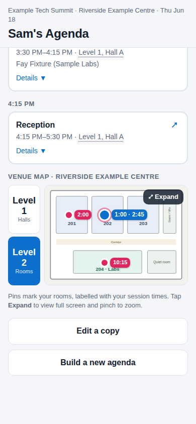
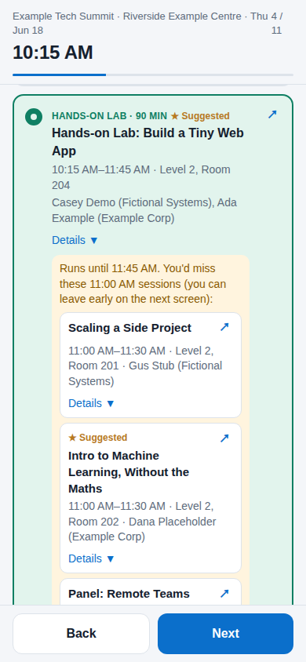
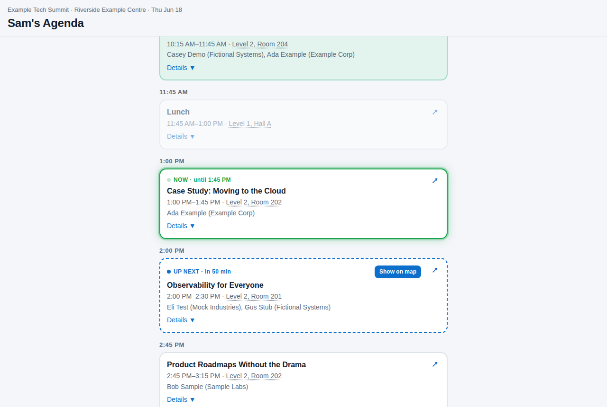

# Agenda Builder

A phone-friendly page for building your own schedule at a conference or event.

- **One screen per time slot.** Pick a session (tap **Details** for the description and speakers) or skip.
- **Save and share.** You get a short link like `http://…/a/Xy3kP9qL` to reopen on your phone or send to friends.
- **Knows the time.** On the day of the event, the saved agenda highlights what's on **now** and what's **up next**.
- **Long sessions handled.** If you pick a 90-minute workshop, it warns you which talks you'd miss, and lets you leave early.
- **Optional venue maps** with a pin on each of your rooms.
- **Optional suggestions** (★) with a reason, if you want to recommend sessions to friends.

It works for any event. You give it the agenda as a couple of files, and it does the rest. A made-up sample event is included so you can try it straight away.

<table>
<tr>
<td align="center"><br><b>Your schedule</b><br>What's on now is highlighted</td>
<td align="center"><br><b>Venue map</b><br>A pin on each of your rooms</td>
<td align="center"><br><b>Picking</b><br>Warns what a long session overlaps</td>
</tr>
</table>



*Screenshots use the made-up sample event in `samples/example-event/`.*

It runs with Docker, a free tool that runs ready-made software packages ("containers") with one command. You don't need to know how to program.

---

## What you need

1. **A computer** (Windows, Mac or Linux). It only needs to stay on while people use the page.
2. **Docker**
   - Windows or Mac: install [Docker Desktop](https://www.docker.com/products/docker-desktop/) and start it.
   - Linux: follow [the official install guide](https://docs.docker.com/engine/install/).
   - To check it works, open a terminal (on Windows, "PowerShell") and type `docker compose version`. You should see a version number.
3. **This folder** on your computer. Download it as a ZIP from the project page and unzip it, or run `git clone <project address>`.

---

## Step 1: Try the sample event (about 5 minutes)

Open a terminal **in this folder** and run:

```
docker compose up -d
```

The first run downloads and builds everything, which takes a few minutes. `-d` means it keeps running in the background.

Open **http://localhost:8000** in your browser. You should see "Example Tech Summit". Click **Start**, pick a few sessions, and save.

To pretend it's the day of the event, add `?now=10:30` to the end of a saved agenda's address, e.g. `http://localhost:8000/a/Xy3kP9qL?now=10:30`. The session running at 10:30 lights up.

If something doesn't work, see [Troubleshooting](#troubleshooting).

---

## Step 2: Make a folder for your event

1. Copy the folder `samples/example-event` into `events/` and rename it, e.g. `events/my-conference`. (Files inside `events/` are never uploaded if you use git.)
2. Make a copy of `.env.example` and name it `.env`. The name starts with a dot. On a Mac or Linux, files that start with a dot can be hidden: press Cmd+Shift+. in Finder to show them, or run `cp .env.example .env` in a terminal.
3. Open `.env` in any text editor (Notepad, TextEdit, etc.) and change the `EVENT_FOLDER` line to:
   ```
   EVENT_FOLDER=./events/my-conference
   ```

Your event folder holds these files. Only the first two are required:

| File | What it is |
|---|---|
| `event.json` | The event's name, date, timezone and a few lines of text |
| `sessions.json` | Every session: times, title, room, description, speakers, link |
| `picks.json` | Optional. Sessions you suggest, each with a reason |
| `rooms.json` + `maps/` | Optional. Floor-plan images and where each room is on them |
| `slots.json` | Optional. Worked out automatically; only needed to fine-tune (see [Time slots](#time-slots)) |

---

## Step 3: Fill in `event.json`

Open `events/my-conference/event.json` and change the values:

```json
{
 "id": "my-conference-2026",
 "name": "My Conference",
 "subtitle": "City Convention Centre · Tue Oct 6",
 "date": "2026-10-06",
 "timezone": "America/Chicago",
 "venue": "City Convention Centre",
 "intro": "Pick one session per time slot, then save to get a link you can reopen or share.",
 "skip_note": "Expo hall, meetings, coffee.",
 "link_label": "Open on the conference website",
 "maps": []
}
```

- `id`: a short name with no spaces, e.g. `devfest-2026`. Saved agendas remember it.
- `date`: the day of the event, written as **YYYY-MM-DD**. This turns on the "now / up next" highlights on that day.
- `timezone`: where the event happens, as a Region/City name like `Europe/London` or `America/New_York` ([full list](https://en.wikipedia.org/wiki/List_of_tz_database_time_zones), "TZ identifier" column).
- `maps`: leave as `[]` (empty) unless you add maps (see [Venue maps](#venue-maps-optional)).

---

## Step 4: Add the sessions

Choose one of these.

**A. Ask an AI assistant to do it (easiest for a big agenda).** If you use an AI coding assistant such as Claude Code, open it in this folder and say:

> Read AGENTS.md. Build an event folder in events/my-conference from this agenda: `<link to the event's agenda page>`

It reads the agenda, writes the files and checks them. `AGENTS.md` tells it how.

**B. Use a spreadsheet.**
1. In Excel, Numbers or Google Sheets, make a sheet with these column headings: `start`, `end`, `title`, `room`, `description`, `speakers`, `url`, `fixed`, `lab`. Only `start`, `end` and `title` must be filled in. See `samples/example-sessions.csv` for an example.
   - `start` / `end`: times like `9:30 AM` or `14:00`.
   - `speakers`: `Name (Job title, Company); Name (Company)`, with `;` between people.
   - `fixed`: write `yes` for things everyone sees and nobody chooses, such as registration or lunch.
   - `lab`: write `yes` for hands-on sessions. They get their own colour. (Titles containing "Lab" or "Workshop" get it automatically.)
2. Save or download it as **CSV** into your event folder, e.g. `events/my-conference/agenda.csv`.
3. Run:
   ```
   docker compose run --rm -v ./events/my-conference:/work app python /srv/tools/csv_to_sessions.py /work/agenda.csv /work/sessions.json
   ```
   It prints `Wrote N sessions`. Run it again whenever you change the spreadsheet. (With Python installed you can instead run `python3 tools/csv_to_sessions.py events/my-conference/agenda.csv events/my-conference/sessions.json`.)

**C. Edit `sessions.json` by hand.** Each session looks like this:

```json
{
 "id": "s03",
 "start": "10:15",
 "end": "10:45",
 "title": "Getting Started with Event Data",
 "room": "Level 2, Room 201",
 "description": "A gentle introduction.",
 "speakers": [{"name": "Dana Placeholder", "role": "Data Scientist", "org": "Example Corp"}],
 "url": "https://example.com/agenda/s03"
}
```

Times are 24-hour (`14:00`, not `2:00 PM`). Each `id` must be different. Add `"fixed": true` for registration, lunch and similar, and `"lab": true` for hands-on sessions.

---

## Step 5: Check and start

Check your files. This tells you exactly what's wrong if anything is:

```
docker compose run --rm app python /srv/tools/check_event.py /event
```

You should see `OK: My Conference` and a list of time slots. Then start (or restart) the page:

```
docker compose up -d --build
```

Open **http://localhost:8000**. After any change to your event files, run `docker compose restart` and reload the page.

---

## Suggestions (optional)

To mark sessions with ★ and a reason, put this in `picks.json` (use the session ids from `sessions.json`):

```json
{
 "s05": "Hands-on and practical: you leave with a working project.",
 "s15": "Short and useful: a checklist you can apply the next day."
}
```

Delete the file, or make it `{}`, for no suggestions.

## Venue maps (optional)

1. Save a picture of each floor (PNG, JPG or SVG) into your event folder's `maps/` folder, e.g. `maps/level-2.png`. Venues often publish floor plans on their website.
2. Add each one to `maps` in `event.json`, with the picture's size in pixels (on Windows: right-click > Properties > Details; on a Mac: open it in Preview > Tools > Show Inspector):
   ```json
   "maps": [
    {"id": "2", "name": "Level 2", "short": "Rooms", "image": "level-2.png", "width": 1000, "height": 700}
   ]
   ```
3. In `rooms.json`, say where each room is on its map, as a **percentage** from the left (`x`) and from the top (`y`). The room names must match the `room` in `sessions.json` exactly:
   ```json
   {
    "Level 2, Room 201": {"map": "2", "x": 17, "y": 30}
   }
   ```
   A quick way to find the percentages: open the picture in an image editor, hover over the room and divide the pixel position by the picture's width (or height), times 100.

Rooms without a pin are still shown, just without a map link.

## Time slots

The app makes one screen per start time. A start time with only one session (say, the keynote) is shown but not chosen, and so are sessions marked `fixed`.

If that's not quite right, for example the event has talks starting at 1:30 and 1:45 that should be one choice, write the slots to a file and edit them:

```
docker compose run --rm -v ./events/my-conference:/work app python /srv/tools/make_slots.py /work
```

Open the new `slots.json`, move session ids between slots or change the `label`, then check again (Step 5).

## Opening the page from other devices

By default the page only works on the computer that runs it.

To open it from phones **on the same Wi-Fi**: in `.env`, set `BIND=0.0.0.0`, run `docker compose up -d`, and open `http://<your computer's local address>:8000` on the phone. The address usually starts with `192` or `10`; your computer's network settings show it.

To share it with friends **over the internet**, you need a hosting setup of your own (for example a small cloud server or a tunnel service, with HTTPS). Keep in mind:

- There is **no login**. Anyone with the address can build and save agendas, and anyone with an agenda's link can see it. Agenda links are random and hard to guess, and an agenda only holds session choices from the public agenda, so that's usually fine. The optional name ("Sam's Agenda") stays on the phone that made it and is never sent.
- Saving is capped at 20,000 agendas in total, so a misbehaving visitor can't fill the disk.

## Updating to a new version

```
git pull
docker compose up -d --build
```

Saved agendas are kept in a Docker volume, so they carry over.

**Warning:** `docker compose down -v` deletes the volume, which deletes **all saved agendas**. Plain `docker compose down` (without `-v`) is safe.

## Running without Docker (optional)

With Python 3.11 or newer:

```
python3 -m venv .venv
.venv/bin/pip install -r requirements-dev.txt          # on Windows: .venv\Scripts\pip
EVENT_DIR=events/my-conference .venv/bin/uvicorn --app-dir app main:app --port 8000
```

Run the tests with `.venv/bin/python -m pytest`.

---

## Troubleshooting

**See what's going on:** `docker compose logs app`. Add `-f` to keep watching, and press Ctrl+C to stop.

- **The page doesn't load and the log shows `EventError`**: something in your event folder is wrong. The message says what and where. Fix it, then run `docker compose restart`.
- **The page still shows the sample event**: `EVENT_FOLDER` in `.env` isn't set, or `.env` is in a different folder. Run `docker compose up -d` after changing it.
- **"port is already allocated"**: something else uses port 8000. Set `PORT=8001` in `.env`, run `docker compose up -d`, and open http://localhost:8001.
- **"Now" and "up next" never show**: check `date` and `timezone` in `event.json`. They only show on that date, in that timezone. Test any time with `?now=10:30` on a saved agenda's address.
- **An old agenda link says it was made for a different event**: you switched `EVENT_FOLDER` to another event. Switch back to view it.
- **A changed map picture doesn't show**: reload the page. The address of each map includes the file's last-changed time, so caches pick up new versions.

## How it's built (for the curious)

- `app/main.py`: the web server (Python, FastAPI). It serves the page and saves each agenda as a small file.
- `app/event.py`: reads and checks an event folder.
- `app/static/index.html`: the whole page, one file, no build step.
- `tools/`: `check_event.py`, `csv_to_sessions.py`, `make_slots.py`.
- `samples/example-event/`: the made-up sample event.

## Credits and license

Made by Graeme Crawley. MIT license: see [LICENSE](LICENSE). Use it, change it and share it.
